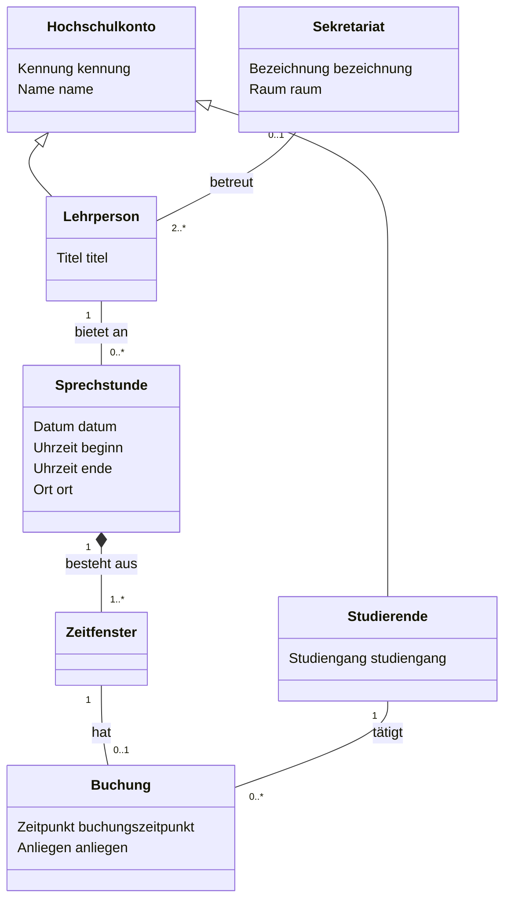

# Klassendiagramm – Daten des Terminplaners

Das Hochschulkonto ist die gemeinsame fachliche Basisklasse der beiden Kontorollen. Die Formulierung „mehrere Lehrende“ wird als mindestens zwei betreute Lehrpersonen gelesen.
