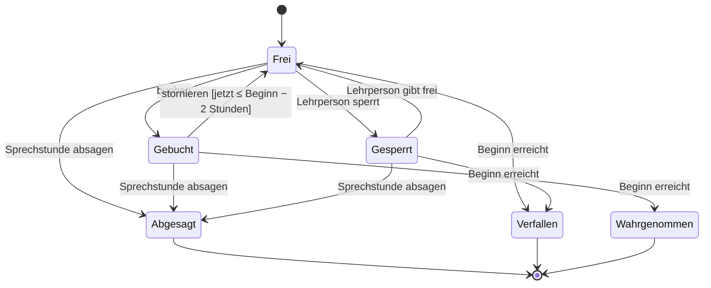

# Zustandsdiagramm – Lebenszyklus eines Zeitfensters

Die Stornierungsgrenze wird einschließlich des Zeitpunkts genau zwei Stunden vor Beginn verstanden. Die Übergänge zum UML-Endknoten schließen den Lebenszyklus ab.
