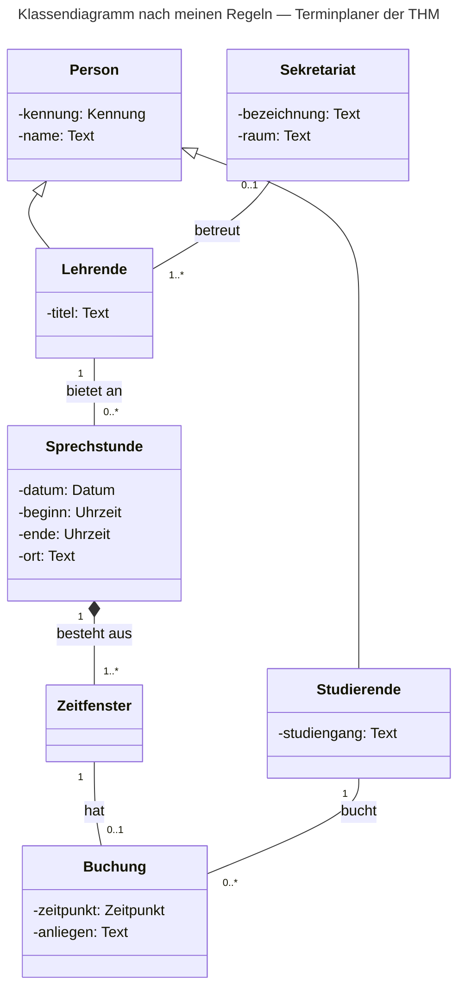

# Klassendiagramm nach meinen Regeln — Terminplaner der THM

Modell zu Beschreibung 3 in [`fall.md`](../fall.md), entstanden mit den
Regeln aus „Meine Regeln für Datenmodelle“ in
[`vergleich.md`](vergleich.md). Zum Vergleich: die frühere Fassung ohne
Regeln steht in [`klassen.md`](klassen.md).

Angewandte Regeln:

1. Keine künstlichen Schlüssel — keine `id`-Attribute; Personen werden über
   ihre fachliche Kennung identifiziert.
2. Fachliche statt technischer Datentypen — `Kennung`, `Text`, `Datum`,
   `Uhrzeit`, `Zeitpunkt` statt `String`, `Date`, `Time`, `DateTime`.
3. Nichts erfinden — nur Klassen und Attribute, die in Beschreibung 3
   genannt sind; keine Operationen. `Zeitfenster` hat dort keine Attribute,
   die 15-Minuten-Einteilung stammt aus Beschreibung 1.
4. Jedes Assoziationsende trägt eine Multiplizität, gelesen in Richtung des
   Verbs am anderen Ende.
5. Komposition (`*--`), wo die Beschreibung das Mitlöschen nennt — nur bei
   `Sprechstunde` und `Zeitfenster`.

