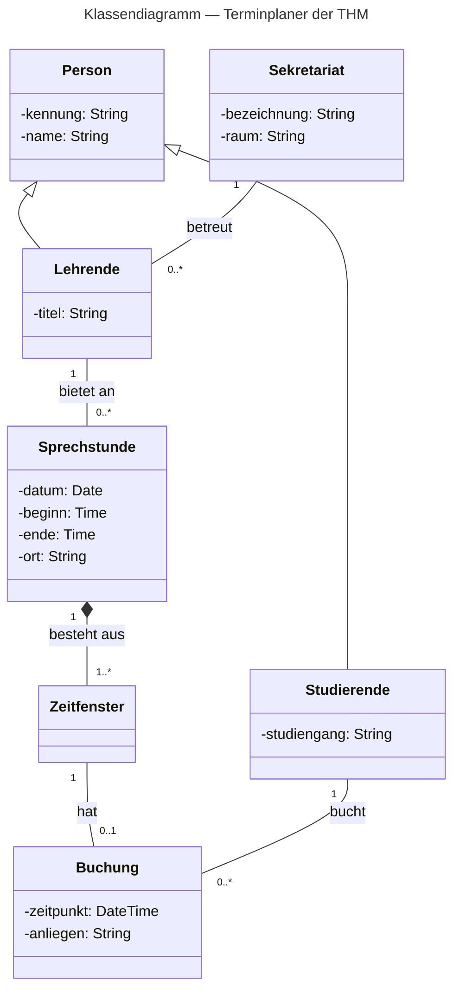

# Klassendiagramm — Terminplaner der THM

Modell zu Beschreibung 3 in [`fall.md`](../fall.md). Die Multiplizitäten
stehen an den Enden der Assoziationen, die Leserichtung folgt dem jeweiligen
Verb.

